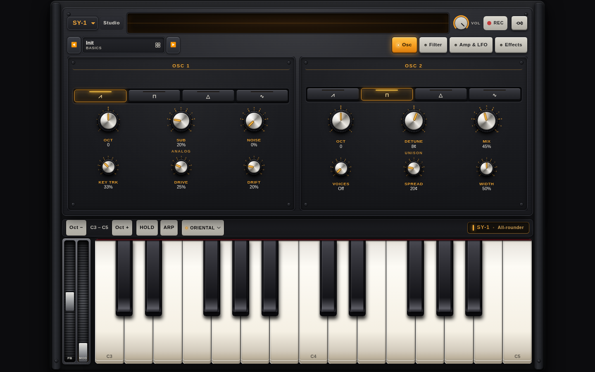
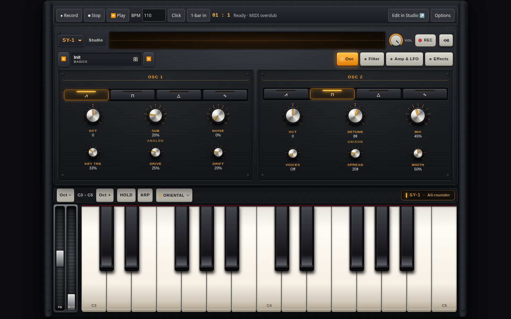
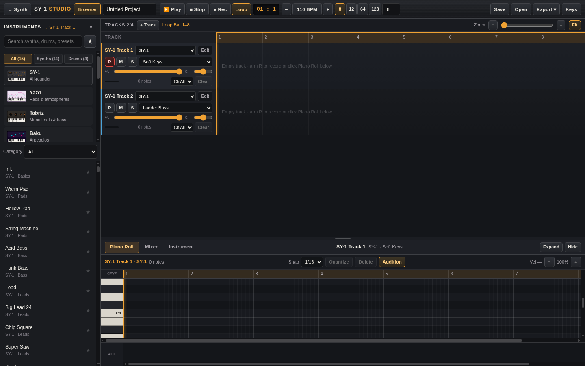
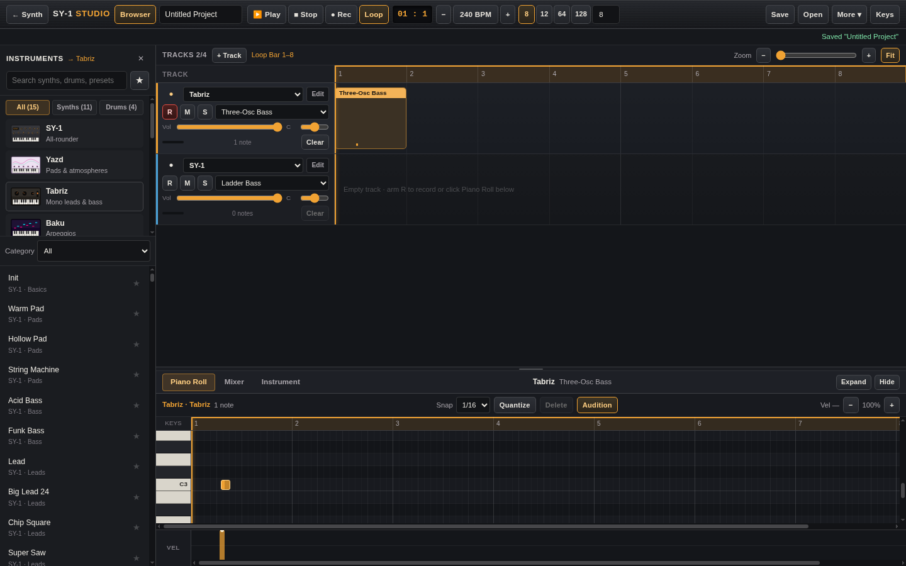
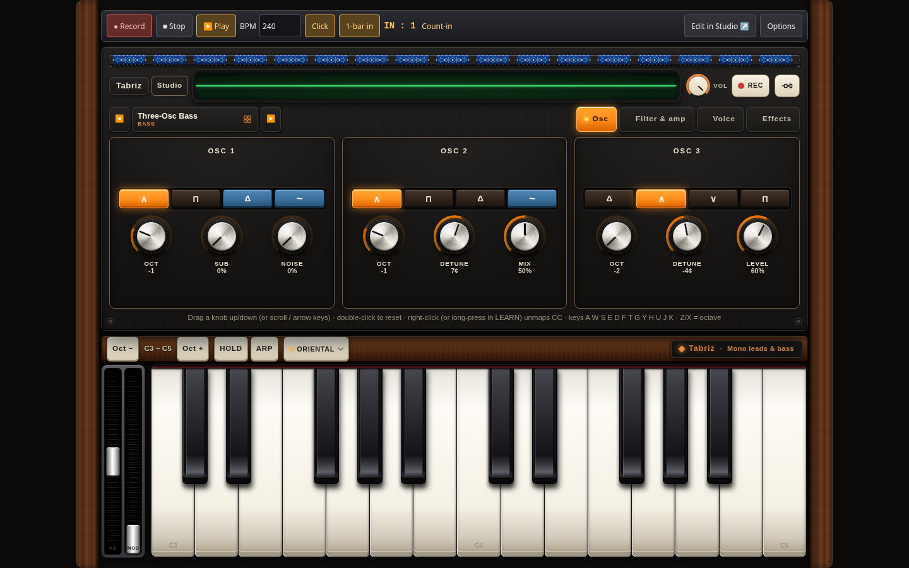
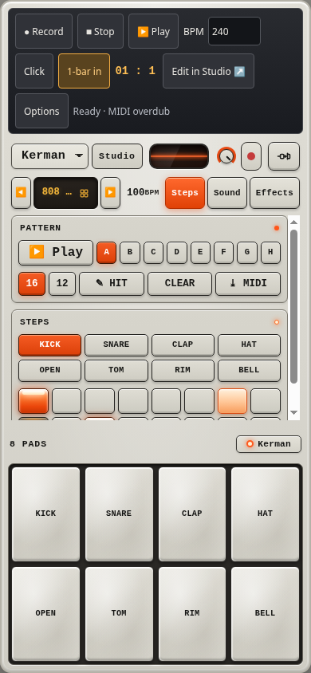

# Phase 5 — Synth → Record → Studio

Base: main `82e8b700b2ebaad8c238e743ed7bde0e440a5253`, verified on GitHub before work.
Branch: `feat/synth-recording-workflow`. No merge, deployment, release or installation.
The previous recovery PR is already in this base; no working systems were restarted.

## Delivered workflow

The web synthesizer now has a compact transport outside the original hardware panel:
Record, Stop, Play, project BPM, click toggle, optional one-bar count-in, bar/beat,
count-in/recording/playback status, click volume in Options, and Edit in Studio.
Count-in is off by default for compatibility and can be enabled in either view.

Record captures the original synthesizer's sounding MIDI into the existing
`SY1StudioEngine`. It does not replay the live input through a second track voice.
The existing MIDI output adapter exposes an observer for sounding notes, generated
arpeggiator/drum notes, bend and modulation, including when external MIDI out is off.
The original MIDI output and legacy audio-take recorder remain available.
The new transport records **project MIDI**, not a new audio clip or second recorder.
Its mixed audio and stems are rendered by the existing Studio export paths.

Matching machine **and patch** reuses a track. An empty track can be repurposed, then
an additional track is created if required. At the existing four-track limit, a full
project is rejected with a visible message; no recorded track is silently replaced.
Overdub appends events. Stop closes held notes. Studio shows the same project and
focused instrument/Piano Roll; returning to the standalone view retains project data.
The standalone panel remains independent rather than silently adopting Studio edits.

Patch values, instrument identity, standard controllers and events persist with the
project. Optional recording preferences extend v1 project metadata without a format
version change; older files receive safe defaults. Existing autosave is reused, with
recording-view flushes on page hide and an explicit in-memory warning on save failure.

## Audio clock and safety

`StudioMetronome` uses the existing transport lookahead callback and shared AudioContext.
Oscillators are scheduled in audio time, with an accented downbeat, independent volume,
deduplication and on-ended disconnection. Stop/seek/tempo changes cancel queued clicks.
Count-in delays the transport's song anchor by four beats; early MIDI is monitored but
not recorded. Stop invalidates pending asynchronous starts. Audio interruptions retain
the count-in anchor while the audio clock is suspended.

Click output connects only to the monitoring destination, never the Studio master tap
or offline render graph. A real Chromium comparison found zero differing WAV bytes
with the click enabled versus disabled. No click-in-export option is introduced.

The adapter change in `src/engine/daw.ts` is MIDI observation only. No synthesis,
filters, envelopes, effect processing or gain staging were changed. `native/**`,
`plugin/**`, `src/dsp/**`, machine definitions/presets, original panel renderer, skins
and keyboard implementation are unchanged. New controls are web-only; plugin UI
initialization does not install them or subscribe the observer.

## Studio simplification

Track headers show one instrument name in the selector, a compact focus target and
the existing Edit button. Redundant visible track-number titles are removed, without
discarding custom names in saved project data. The dock title also avoids duplication.
MIDI channel routing moves to the secondary Mixer. The former Export menu is now
More, retaining all export/import actions and adding shared recording preferences.
Mixer, Expand/Split, touch Piano Roll/Drum Grid and original instrument views remain.

## Executed verification

Environment: Linux, real headless Chromium, Node 24.22.3, Bun 1.3.3, Vite 8.3.8.
The five sizes below are browser emulation, not physical device tests.

| Check | Result |
| --- | --- |
| Baseline main | 50 existing unit tests passed; fresh Synth and Studio captures taken before edits |
| TypeScript lint / production build | PASS |
| Phase 1–4, recovery and Phase 5 unit suites | PASS — 58 tests, 10,635 assertions |
| Existing real Chromium Phase 1–4 verification | PASS — DSP parity, isolation, recording, Piano Roll, project/MIDI/WAV interchange, 2/4-track stem alignment/null tests, storage errors and scheduling/resource checks |
| Existing recovery Chromium suite | PASS — 20 layout cases, six real audio engines, switching race, mixed instrument isolation and exports, keyboard menu/Drum Grid/dock resize |
| Synth Record → Stop → Studio → Piano Roll | PASS with actual CDP pointer input |
| Early count-in input exclusion / count-in cancel / tempo/interruption timing | PASS in browser and/or deterministic audio-clock tests |
| Overdub and mixed Tabriz/Yazd/Baku/Kerman performances | PASS; existing notes preserved |
| Web MIDI routing fixture | PASS — simulated device through the real MIDI input handler, including velocity, sustain and bend; not a physical controller |
| Shared live audio graph | PASS — one live AudioContext across synth recording, playback and mixed instruments |
| Metronome audio timing/accent/cleanup | PASS — real OfflineAudioContext click windows, stronger downbeat, silent gaps and zero remaining oscillator voices |
| Click excluded from exported audio | PASS — 24-bit WAV comparison identical with click on/off; stems use the same isolated offline track architecture |
| Save → Refresh → Restore | PASS — exact notes, controllers, patches, identities and recording preferences |
| Simulated save failure | PASS — visible warning; performance retained in memory |
| 1440×900 / 1280×800 / 1024×768 / 768×1024 / 390×844 | PASS — Synth toolbar, Options volume control, Studio and More menu captures and bounds checks |
| Native macOS/iPadOS Safari, physical MIDI, touch hardware, Ableton/VST CPU | NOT RUN |

The existing maximum of four tracks is retained. Knob movement is retained as patch
state; this does not add a new arbitrary parameter-automation recording system.
The legacy Studio live audio take retains its existing behavior; enabling count-in
can include the silent lead-in in that take. The new Synth transport is MIDI-only.
Mix/stem exports begin at the arrangement timeline and exclude the count-in/click.
No improvement to native Ableton CPU usage is claimed.

## Files and evidence

- Engine/adapter: `src/engine/daw.ts`, `src/studio/{studio-engine,metronome,synth-recording,types,project-io}.ts`.
- Integration/UI: `src/main.ts`, `src/ui/{synth-recording.ts,synth-recording.css,studio-panel.ts,studio.css}`.
- Verification: `tests/studio-phase5.test.ts`, `scripts/studio-phase5-verify.mjs`.
- Documentation and selected screenshots: this report and `docs/evidence/studio-phase5/`.
- Complete browser captures, test logs and source revision metadata are in the delivery evidence archive.

Before and after Synth:




Before and after Studio:




Count-in and portrait phone fallback:




## Reproduce

```sh
npm ci
npm run lint
npm run build
bun test --preload ./tests/vite-url-preload.ts tests/studio-*.test.ts
# In an environment with a reachable local Vite server:
SY1_CHROME_BIN=/path/to/headless-shell node scripts/studio-chromium-verify.mjs
SY1_CHROME_BIN=/path/to/headless-shell node scripts/studio-recovery-verify.mjs
SY1_CHROME_BIN=/path/to/headless-shell node scripts/studio-phase5-verify.mjs
```

Use a disposable local test browser; existing suites clear their fixture storage.
Chromium/Bun remain external test prerequisites; product dependencies are unchanged.

Ready for a review-only PR after successful verification. **Stop before merge.**
