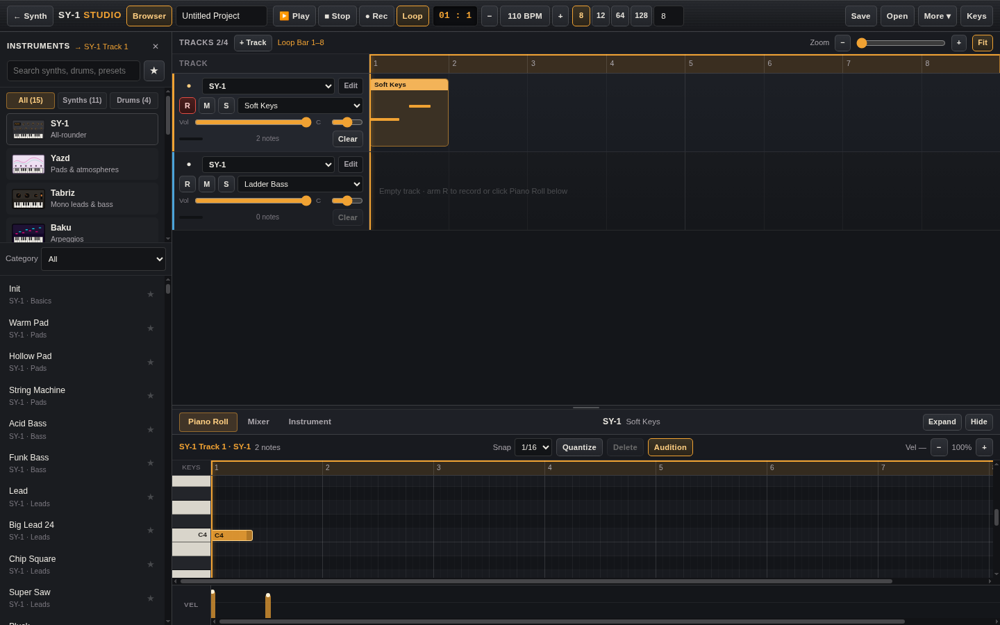
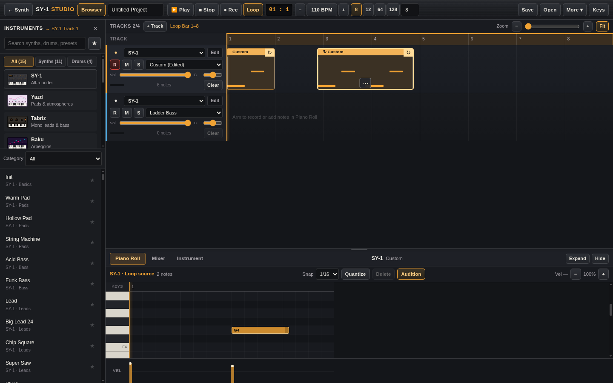
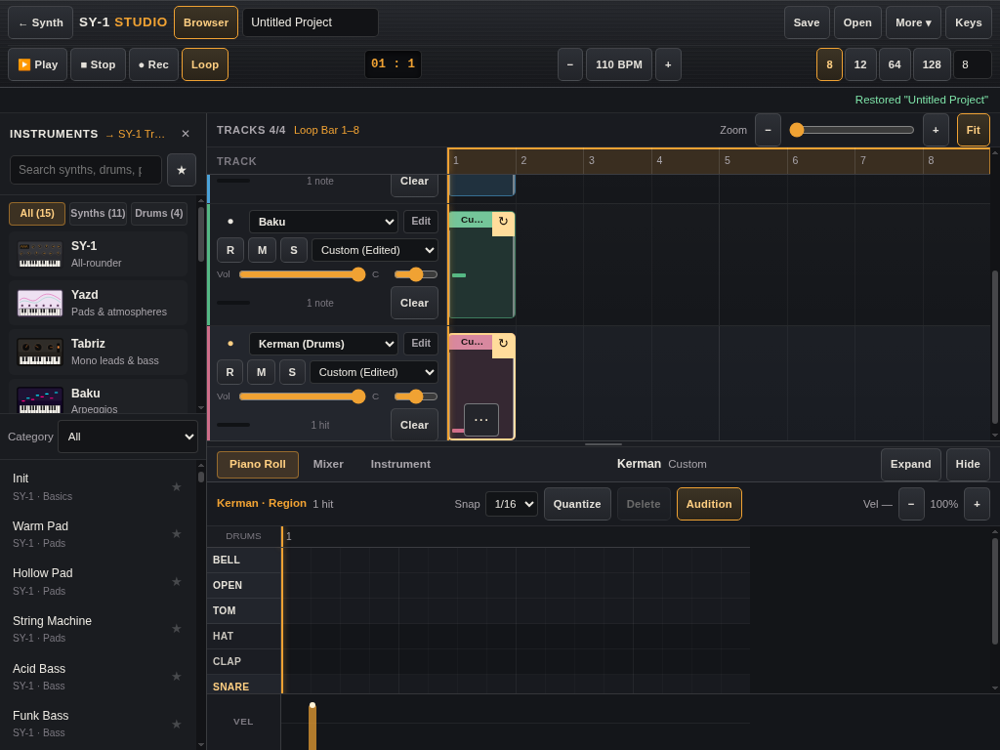

# Phase 6 — MIDI region editing

Base: main `0ba71fc54bb3a0ec9498db459d62bedb3f0e093a`. Branch: `feat/midi-region-editing`.

The previous timeline inferred one decorative rectangle per track from its notes. The Piano Roll edited an entire track, and recording, playback and exports read its flat tick stream. Phase 6 separates stable region sources and their visible windows from the projected track events used by those existing paths.

## Controls

- Click or tap a region to select it. Shift/Cmd/Ctrl adds or removes a desktop selection. On touch, use **Select multiple regions** from the selected region's **···** menu or long-press menu.
- Drag the body to move the selection. Drag the lower left or right edge to trim. Drag the upper-right repeat handle to loop. The region menu contains the snap grid and **Repeat to arrangement end**.
- Double-click to edit the selected region in Piano Roll or Drum Grid. The context menu provides the same action and **New region here**.
- Cmd/Ctrl + C, X, V, D and T perform copy, cut, paste, duplicate and split at playhead. Cmd/Ctrl + Z undoes, Shift + Cmd/Ctrl + Z or Ctrl + Y redoes. Delete/Backspace removes selected regions, and arrows nudge a focused region selection.
- Use the context menu to merge. Paste targets the focused track at the playhead or the track and snapped position under **Paste here**. Clearing an entire track asks for confirmation and can be undone.

Regions store identity, owner, source MIDI, source length, arrangement start, visible length, offset and loop state. Trim and split retain source data. A merge can combine complete non-overlapping regions on one track or consecutive slices of the same source. Cross-track paste requires the same instrument. Undo/redo stores up to 50 edits including completed takes.

MIDI recording keeps the original input and transport. A take overdubs a compatible complete source when it fits, or creates an independent region. At the actual Loop boundary, held notes close at the end and reopen at the start with their original velocity. **Edit in Studio** selects the latest take region and opens its editor. During recording, edit and seek commands are gated so they cannot rewrite material under the recorder. During playback, an edit clears old queued notes, disconnects stale drum audio paths, and re-anchors the scheduler.

Version 1 projects without regions retain their MIDI event stream and appear as one region for each populated track. New saves include optional region metadata and a flattened event list for older readers. Validation checks ownership, IDs, coordinates, and source/render limits before loading. Trimmed or repeated regions materialize audible windows, including controller state at their left edge.

## Verification

| Check | Result |
| --- | --- |
| TypeScript lint and Vite production build | PASS |
| Phase 1–5, recovery and Phase 6 Bun suites | PASS, 68 tests and 10,701 assertions |
| Existing Phase 1–4 Chromium regression | PASS, including timing, isolation, exports, audio parity and resource cleanup |
| Existing Recovery Chromium regression | PASS, including 20 layout cases, six engine routes and mixed-track audio isolation |
| Existing Phase 5 Chromium regression | PASS, including 30 recording, metronome, save and UI checks |
| New Phase 6 Chromium E2E | PASS, 20 checks, including desktop pointer moves/trim/loop, shortcuts, touch long-press and resize, Drum Grid, save/reload and five viewport sizes |
| Migration audio parity | PASS, byte-identical dry SY-1 stem before and after migration |
| Regional mix, stems and MIDI | PASS, non-silent 24-bit stereo mix and four aligned stems for Tabriz, Yazd, Baku and Kerman, plus Standard MIDI export |
| Physical iPad, Mac/Safari and external MIDI | NOT RUN. Linux Chromium with viewport and touch emulation was used. |

The browser report is [published with the screenshots](evidence/studio-phase6/browser-report.json).

## Evidence

## Changed source and tests

- Region model and commands: `src/studio/midi-regions.ts`, `src/studio/region-editor.ts`.
- Track projection, transport, recording and persistence: `src/studio/track-engine.ts`, `src/studio/studio-engine.ts`, `src/studio/types.ts`, `src/studio/project-io.ts`, `src/studio/synth-recording.ts`.
- Arrangement, Piano Roll and Synth-to-Studio entry: `src/ui/studio-regions.ts`, `src/ui/studio-panel.ts`, `src/ui/studio-piano-roll.ts`, `src/ui/studio.css`, `src/ui/synth-recording.ts`.
- Verification: `tests/studio-phase6.test.ts`, `scripts/studio-phase6-verify.mjs`.
- Delivery: this report and `docs/evidence/studio-phase6/`.

To run the tests, start a local Vite server on port 3000, set `SY1_CHROME_BIN` to a Chromium headless-shell executable, and run the four `scripts/studio-*-verify.mjs` regression scripts. For unit coverage use `bun test --preload ./tests/vite-url-preload.ts tests/studio-*.test.ts`.

The clip clipboard is internal to the Studio session and selection/history are transient. A loop edits one visible source pass, and its repetitions share that source. Overlapping clips sharing a pitch use the existing instrument retrigger behavior. Editing during playback clears sounding voices briefly before the new timeline continues. Original DSP, machine definitions, native and plugin sources have no changes.

**SAFE TO MERGE based on automated verification, pending user approval.**
