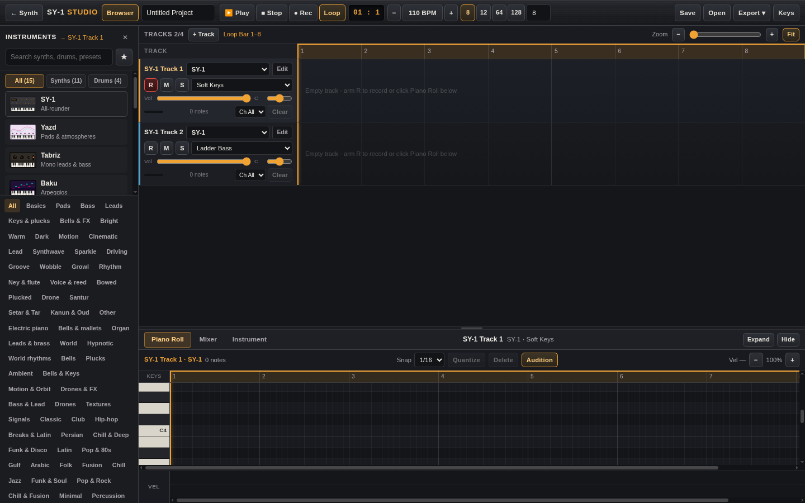
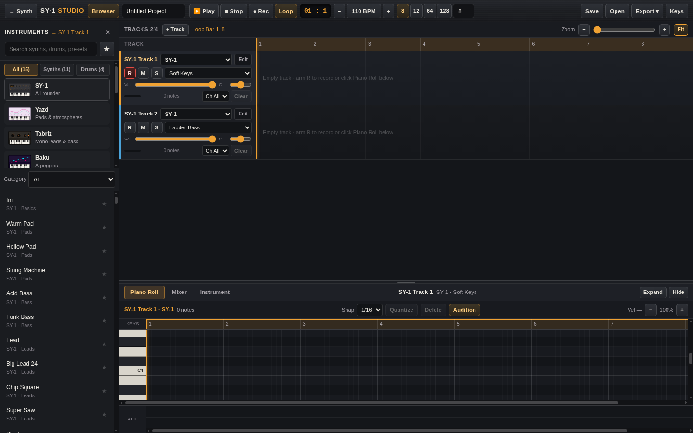
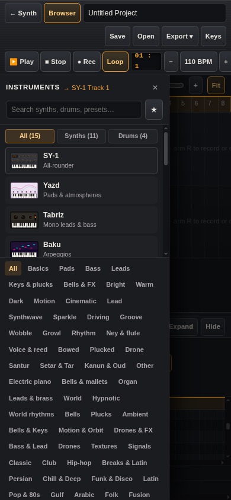
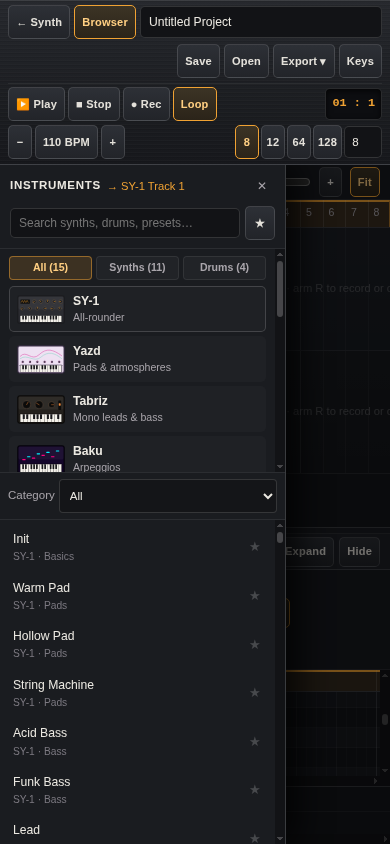

# SY-1 Studio recovery — 2026-11-21

## Scope and revision

Source of truth: `armshokri-debug/Synthesizer-New`, verified main
`23cd2f25d7c397c7a4d3f2e71c22c1f8f7c4234d` (checked again before delivery).
Repair branch: `repair/studio-final-stabilization`. Working tree was clean before work.
This report supersedes earlier success claims only for the checks explicitly listed below.
No main update, merge, deployment, release, installation, or user-project change occurred.

## Recovered implementation

Phases 1–4 already provide separate track graphs, scheduling/recording, IndexedDB
projects/autosave, project and MIDI interchange, offline mix/stem rendering, arrangement
zoom/loop controls, Piano Roll editing, mixer/meters, and the embedded instrument view.
Relevant implementation: `src/studio/{studio-engine,track-engine,storage,project-io,midi-io,parity-probe}.ts`
and `src/ui/{studio-panel,studio-piano-roll,studio-instrument}.ts` / `studio.css`.

The committed post-Phase-4 work already exposes **11 synths and 4 drum machines**.
It is not necessary to replace this architecture. Track-header instrument/preset selectors,
kit selection, drum audition pads, and the GM-mapped Drum Grid already exist.
Routes are HQ (including Yazd/Baku), Analog (Tabriz), Strings (Shiraz), FM (Kashan),
Vector (Nishapur), and the actual drum synthesis/bus for Kerman/Bushehr/Rasht/Hormoz.
Yazd and Baku intentionally share the HQ processor with their own machine patches;
this is distinct from routing every machine through a renamed SY-1 preset.

## Proven defects and repairs

| Problem / evidence | Repair |
| --- | --- |
| Original Bun preload failed resolving transitive worker URL imports; no suites could start. | Test-only mocks of resolved worklet URL modules. Real browser tests still execute real worklets. |
| Phase 4 expected seven machines although the implementation has eleven synths. | Explicit current catalog expectation; retained all preset-isolation assertions. |
| Browser category chips consumed nearly all available height. Fresh desktop captures measured a **14 px** preset list. | One labelled, keyboard-accessible native category select; all categories remain available. Fresh list heights: 503/403/323/581/324 px across the five viewports. |
| At 390 px width, tempo/bar controls extended beyond the viewport. | Allow transport groups to wrap within the existing narrow-screen layout. |
| Export menu lacked arrow-key navigation, Escape dismissal, and predictable focus. | Focus the first enabled item on opening; Arrow Up/Down, Home/End, Escape, and focus return. Existing viewport clamping retained. |
| `loadPatchSnapshot()` retained the preceding sustain latch and held-note state. New regression reproduced `true` sustain after replacement. | Release previous notes/sustain before applying the snapshot, matching existing preset-switch semantics. No DSP or patch values changed. |

Unproven engine defects were not “fixed” speculatively. Existing engine swap tokens,
stale-node disconnection, per-track buses, and drum mapping were retained and tested.

## Fresh verification

Environment: Linux x86_64, Node 24.22.3, Bun 1.3.3, Vite 8.3.8, real headless Chromium.
The system Chromium could not create its singleton socket, and Playwright's browser
download returned HTTP 403. A locally installed headless-shell package provided a
working alternative. This is browser viewport emulation, **not macOS/iPad hardware testing**.

| Check | Result |
| --- | --- |
| TypeScript `npm run lint` | PASS |
| Production `npm run build` | PASS; existing Vite config deprecation warning only |
| All Phase 1–4 suites plus recovery suite | PASS — 50 tests, 10,596 assertions |
| Existing Chromium Phase 1–4 verification | PASS before and after product edits |
| Existing real offline SY-1 chain parity, track isolation, WAV header/frame checks | PASS |
| Existing two/four-track stem alignment and mix null tests | PASS |
| Existing recording/playback, Piano Roll, project import/export, IndexedDB refresh/restore and quota paths | PASS |
| Existing scheduling/stall, disposal counters, rapid parameter stress and repeated load/heap checks | PASS within the suite's thresholds, not proof of unlimited-session leak freedom |
| 1440×900, 1280×800, 1024×768, 768×1024, 390×844; Piano Roll/instrument/mixer/export states | PASS — 20 layout cases; preset visibility, lane alignment, transport bounds, menu bounds and menu hit-testing |
| Original visible editor dock, all 15 machines at 1440×900 | PASS — exact before/after pixels in crop `(248,585)-(1440,900)`; does not cover off-screen controls |
| Export arrow-key/Escape/focus behavior; actual CDP mouse Drum Grid edit and dock resize | PASS |
| Six actual engine routes rendered into OfflineAudioContext | PASS — real engine nodes, non-silent finite Float32 output; note/sustain cleanup |
| Rapid cross-engine changes while worklet promises are pending | PASS — final drum graph retained, stale worklet did not replace it |
| Mixed Tabriz/Yazd/Baku/Kerman project | PASS — real Analog/HQ worklets plus actual drum synthesis |
| Mixed 24-bit stereo 48 kHz WAV Mix and four Stems | PASS — each non-silent; altering Tabriz cutoff changed its stem and changed **zero bytes** in the other three stems |
| Mixed project JSON interchange, MIDI header, Save → Refresh → Restore | PASS — four instrument identities preserved |
| Physical MIDI device, real touch input, Safari/iPadOS, macOS audio hardware, Ableton/VST CPU | **NOT RUN** |

The mixed-engine check verifies WAV contents and isolation; existing Phase 1–4 tests
separately cover more detailed MIDI parsing/export and scheduling. These are not claims
of a listening comparison of every preset or of improved native VST CPU consumption.

## Evidence and source hygiene

Fresh baseline/after layout reports and selected before/after screenshots are in
[`evidence/studio-recovery`](evidence/studio-recovery/). The complete screenshot archive
contains all five viewport captures, all fifteen desktop editors, and full test logs.
The 29 previously committed images were relocated without content changes to
[`studio-historical-screenshots`](studio-historical-screenshots/). They remain historical
evidence and are not treated as fresh test results. No product assets were deleted.

Before/after desktop:




Before/after phone transport:




## Reproduction

```sh
npm ci
npm run lint
npm run build
bun test --preload ./tests/vite-url-preload.ts tests/studio-*.test.ts
# Start the Vite server locally, then in the same reachable environment:
SY1_CHROME_BIN=/path/to/headless-shell node scripts/studio-chromium-verify.mjs
SY1_CHROME_BIN=/path/to/headless-shell SY1_EVIDENCE_DIR=/tmp/sy1-after node scripts/studio-recovery-verify.mjs
# With the baseline captures from the evidence archive and Pillow installed:
python scripts/studio-visual-compare.py /tmp/sy1-before /tmp/sy1-after
```

Chromium is an external test prerequisite, deliberately not a product dependency.
The scripts run against a disposable local browser profile; never point them at a
browser containing real user projects, as the existing regression suite clears test storage.

## Change boundaries and delivery decision

Product changes are limited to `src/studio/track-engine.ts`, `src/ui/studio-panel.ts`
and `src/ui/studio.css`. Test harness/scripts, regression coverage and documentation
are updated separately. No changes to `native/**`, `plugin/**`, `src/dsp/**`,
`src/engine/**`, `src/machines/**`, original standalone UI, presets, synthesis/filter/
envelope/effect algorithms, gain staging, or dependency manifests/lockfile.

**SAFE TO PUSH to the dedicated repair branch for review.** This does not authorize
merging or deployment. Hardware sign-off remains open: macOS Safari/Chromium output,
physical MIDI/controllers, iPad touch/Safari interruptions, long sessions, listening
comparisons, and any native Ableton CPU acceptance must be tested on actual devices.
